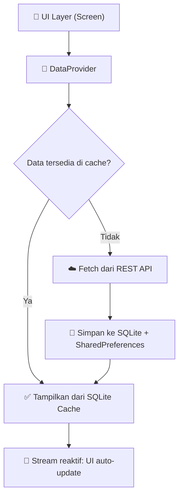

# 📦 MoneyMate — Implementasi Local Storage & Data Persistence (Offline-First)

## 📋 Ringkasan Implementasi

Modul penyimpanan data lokal MoneyMate dibangun dengan pendekatan **offline-first**, di mana aplikasi selalu membaca dari cache lokal terlebih dahulu, lalu menyinkronkan dengan server API di background. Data dipisahkan ke **3 jenis penyimpanan** sesuai dengan tipe dan sifat datanya.

---

## 🗂️ Pemisahan Jenis Penyimpanan

### 1. SQLite Database (Drift) — Data Terstruktur
| Aspek | Detail |
|-------|--------|
| **Package** | `drift` + `sqlite3_flutter_libs` |
| **File** | [`database_service.dart`](file:///c:/SEMESTER_3/MoneyMate/MOBILE/lib/services/database_service.dart) |
| **Tipe Data** | Relasional & tabular (memerlukan query, sort, filter) |
| **Contoh Data** | Transaksi, Kategori, Budget, Pengguna |

**Tabel yang dibuat:**
- `AppUsers` — Data profil pengguna dengan `lastFetched` timestamp
- `CachedTransactions` — Cache riwayat transaksi dari API
- `CachedCategories` — Cache daftar kategori transaksi
- `CachedBudgets` — Cache data anggaran bulanan

**Fitur utama:**
- ✅ **Stream reaktif** (`watchAllTransactions()`) — UI auto-update tanpa manual refresh
- ✅ **Database Transaction** (`saveTransactionsFromApi()`) — Batch write yang aman & atomik
- ✅ **`lastFetched` timestamp** — Penanda kapan data terakhir kali di-cache

### 2. SharedPreferences — Data Ringan (Key-Value)
| Aspek | Detail |
|-------|--------|
| **Package** | `shared_preferences` |
| **File** | [`preferences_service.dart`](file:///c:/SEMESTER_3/MoneyMate/MOBILE/lib/services/preferences_service.dart) |
| **Tipe Data** | Non-sensitif, key-value sederhana (string, bool, int, double) |
| **Contoh Data** | Tema, bahasa, mata uang, flag notifikasi, snapshot saldo |

**Data yang disimpan:**
- `is_dark_mode` — Preferensi tema gelap/terang
- `currency` / `language` — Pengaturan regional
- `notification_enabled` — Toggle notifikasi
- `saldo_snapshot` / `income_snapshot` / `expense_snapshot` — Snapshot keuangan
- `last_sync_time` — Timestamp sinkronisasi terakhir

### 3. Flutter Secure Storage — Data Sensitif (Encrypted)
| Aspek | Detail |
|-------|--------|
| **Package** | `flutter_secure_storage` |
| **File** | [`secure_storage_service.dart`](file:///c:/SEMESTER_3/MoneyMate/MOBILE/lib/services/secure_storage_service.dart) |
| **Tipe Data** | Terenkripsi — data keamanan & autentikasi |
| **Contoh Data** | Access token, refresh token, PIN, kunci biometrik |

**Enkripsi:**
- iOS: **Keychain Services** (AES-256)
- Android: **EncryptedSharedPreferences** (AES-256 GCM)

---

## 🔄 Arsitektur Offline-First



**File orchestrator:** [`offline_first_service.dart`](file:///c:/SEMESTER_3/MoneyMate/MOBILE/lib/services/offline_first_service.dart)

### Alur Offline-First:
1. **BACA** dari cache SQLite lokal terlebih dahulu (instan, tanpa internet)
2. **FETCH** dari API di background (async, jika tersedia)
3. **SIMPAN** hasil API ke cache lokal (SQLite + SharedPreferences)
4. **UPDATE** UI otomatis via Drift Stream (reaktif, tanpa manual refresh)

---

## 📁 Struktur File yang Ditambahkan/Dimodifikasi

### File Baru:
| File | Fungsi |
|------|--------|
| [`database_service.dart`](file:///c:/SEMESTER_3/MoneyMate/MOBILE/lib/services/database_service.dart) | Definisi tabel SQLite + CRUD operations |
| [`database_service.g.dart`](file:///c:/SEMESTER_3/MoneyMate/MOBILE/lib/services/database_service.g.dart) | Generated code dari Drift |
| [`offline_first_service.dart`](file:///c:/SEMESTER_3/MoneyMate/MOBILE/lib/services/offline_first_service.dart) | Orchestrator pola offline-first |
| [`data_provider.dart`](file:///c:/SEMESTER_3/MoneyMate/MOBILE/lib/providers/data_provider.dart) | State management utama (ChangeNotifier) |
| [`user_provider.dart`](file:///c:/SEMESTER_3/MoneyMate/MOBILE/lib/providers/user_provider.dart) | Provider khusus data pengguna |
| [`data_management_screen.dart`](file:///c:/SEMESTER_3/MoneyMate/MOBILE/lib/screens/data_management_screen.dart) | UI halaman manajemen penyimpanan lokal |

### File yang Dimodifikasi:
| File | Perubahan |
|------|-----------|
| [`main.dart`](file:///c:/SEMESTER_3/MoneyMate/MOBILE/lib/main.dart) | Inisialisasi semua service + Provider |
| [`app_router.dart`](file:///c:/SEMESTER_3/MoneyMate/MOBILE/lib/navigation/app_router.dart) | Tambah route `/data-management` dan `/user-data` |
| [`preferences_service.dart`](file:///c:/SEMESTER_3/MoneyMate/MOBILE/lib/services/preferences_service.dart) | Diperluas dengan singleton pattern |
| [`secure_storage_service.dart`](file:///c:/SEMESTER_3/MoneyMate/MOBILE/lib/services/secure_storage_service.dart) | Diperluas dengan singleton + fitur baru |
| [`profile_screen.dart`](file:///c:/SEMESTER_3/MoneyMate/MOBILE/lib/screens/profile_screen.dart) | Tambah menu "Penyimpanan Lokal" |
| [`user_screen.dart`](file:///c:/SEMESTER_3/MoneyMate/MOBILE/lib/screens/user_screen.dart) | Redesign UI sesuai Figma MoneyMate |

---

## 🎨 Desain UI — Sesuai Figma MoneyMate

Semua halaman baru menggunakan design system yang sama:

| Elemen | Implementasi |
|--------|-------------|
| **Warna Primer** | `#592314` (Primary Brown) |
| **Warna Aksen** | `#D95B27` (Accent Orange) |
| **Background** | `#FAF6F0` (Warm Cream) |
| **Font** | Plus Jakarta Sans (Google Fonts) |
| **Card Style** | Rounded corners 16-20px, subtle border `#EFE8E0` |
| **Spacing** | 20px horizontal padding, 8-16px vertical gaps |

---

## 🚀 Cara Menjalankan

```bash
cd MOBILE
flutter pub get
dart run build_runner build --delete-conflicting-outputs
flutter run
```

> [!IMPORTANT]
> Wajib jalankan `build_runner` setelah perubahan pada file `database_service.dart` untuk men-generate file `.g.dart` yang dibutuhkan Drift.

---

## 📍 Akses Halaman Penyimpanan Lokal

Dari dalam aplikasi:
1. Login → Dashboard → Tab **Profil** (bottom nav paling kanan)
2. Ketuk menu **"Penyimpanan Lokal"** (ikon storage)
3. Halaman menampilkan **3 tab**: SQLite, Preferences, Secure Storage
4. Gunakan tombol **"Sync"** untuk menyinkronkan data dari API
